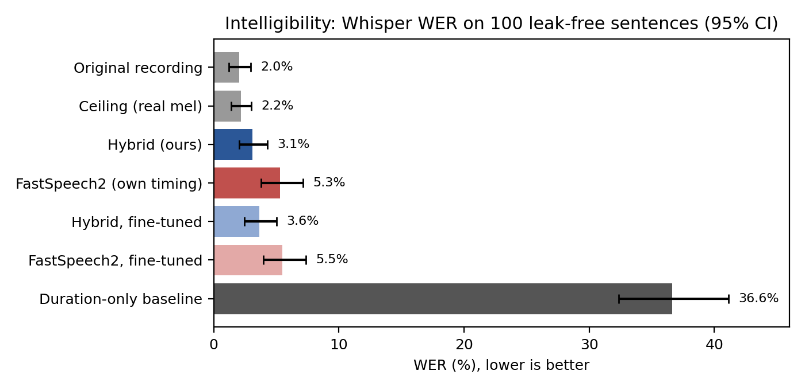
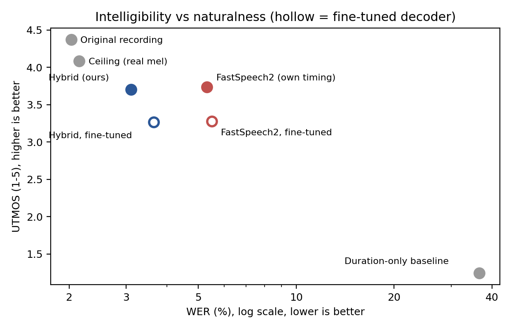
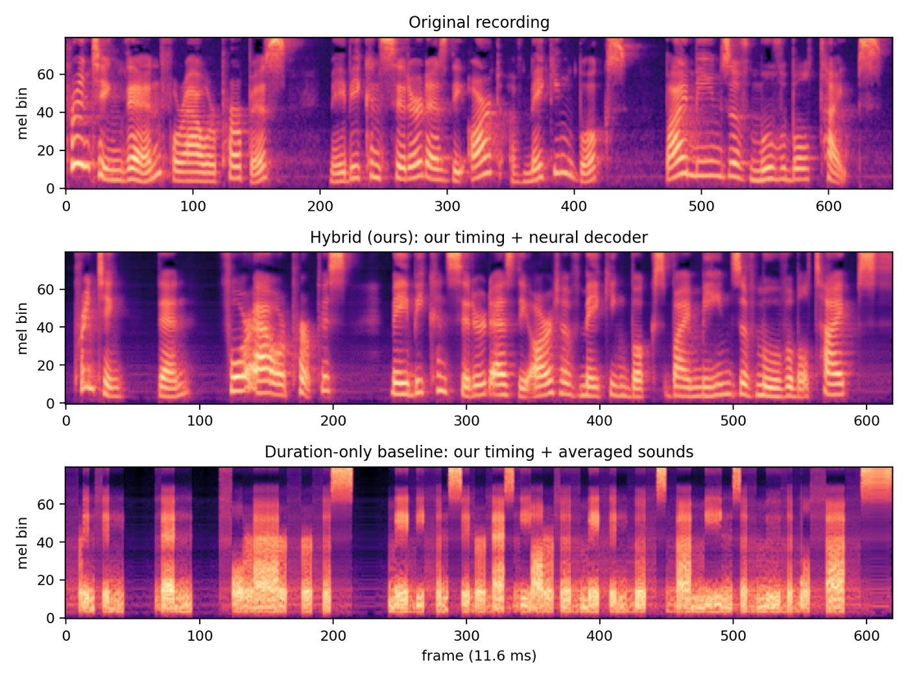
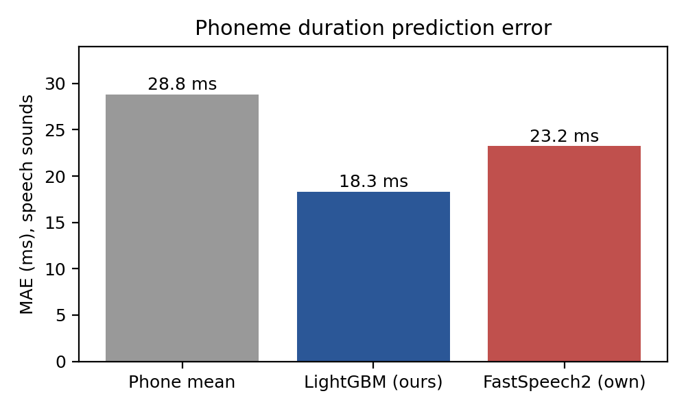

# Phonetic Guided Speech Generation

**Explicit phoneme alignment (AML) + learned acoustic generation (DL) for text-to-speech on LJSpeech**

A small, fully reproducible TTS experiment that asks one question: *if you know exactly **when** every
phoneme happens, how much of good speech do you get for free, and how much needs a learned acoustic model?*

> **Main result.** With identical, fully text-only timing, a duration-only baseline (averaged sounds) reaches
> **36.6 % WER**, while a neural decoder driven by our predicted durations and pauses reaches **3.1 %**, close to
> real recordings (**2.0 %**). Our explicit timing also beats the neural model's own: **3.1 % vs 5.3 % WER**
> at the **same naturalness** (UTMOS 3.70 vs 3.74, difference not significant).
> Alignment decides *when*; learned acoustics decide *how it sounds*.
---

## Pipeline

```
text ──► phonemes (MFA pronunciations)
           │
           ├──► pause classifier (LightGBM, text features)       ─┐   AML
           └──► duration predictor (LightGBM, phonetic context)  ─┤
                                                                  ▼
                        timing plan: phoneme + pause + frames per phoneme
                                   │                         │
                    averaged mel per phoneme        FastSpeech2 decoder        DL
                     (duration-only baseline)    (pretrained / fine-tuned)
                                   └───────────┬─────────────┘
                                               ▼
                                        HiFi-GAN vocoder ──► audio
```

| Component | What | Type |
|---|---|---|
| Forced alignment | Montreal Forced Aligner, `english_us_arpa` | HMM-GMM aligner |
| Duration predictor | LightGBM regressor on phone, neighbours, stress, position, pause context | AML |
| Pause classifier | LightGBM classifier on punctuation, word identity, phrase length | AML |
| Baseline acoustics | one averaged mel frame per phoneme, repeated for its duration | AML only |
| Neural acoustics | SpeechBrain FastSpeech2 decoder conditioned on our durations (pretrained and fine-tuned) | DL |
| Vocoder | SpeechBrain HiFi-GAN (LJSpeech) | DL (shared by all systems) |

## Systems compared

| System | Pause placement | Durations | Sound generator |
|---|---|---|---|
| `original` | real recording | | |
| `ceiling` | real | real | real mel → HiFi-GAN |
| `baseline_true / pred / text` | MFA / MFA / predicted | MFA / LightGBM / LightGBM | averaged mels |
| `hybrid_true / pred / text` | MFA / MFA / predicted | MFA / LightGBM / LightGBM | FastSpeech2 decoder |
| `fastspeech2` | predicted | FastSpeech2's own | FastSpeech2 decoder |
| `*_ft` | same as above | same as above | **fine-tuned** decoder |

`*_text` systems are fully text-only: no information from the test recording is used.

## Results

All synthesis results are on **100 leak-free test sentences**: in our test split **and** held out from the
training of the pretrained FastSpeech2 and HiFi-GAN (SpeechBrain's own 90/10 split, reproduced exactly).
Brackets are 95 % bootstrap confidence intervals (resampling sentences, 5,000 draws).

### Intelligibility (WER from a held-out ASR, Whisper `small.en`) and naturalness (UTMOS)

| System | Decoder | WER | UTMOS (1-5) |
|---|---|---|---|
| original recording | | 2.0 % [1.2, 3.0] | 4.37 |
| ceiling (real mel → vocoder) | | 2.2 % [1.4, 3.0] | 4.08 |
| **hybrid_text (ours, fully text-only)** | pretrained | **3.1 %** [2.0, 4.3] | **3.70** |
| hybrid_pred | pretrained | 2.9 % [1.9, 4.1] | |
| hybrid_true | pretrained | 4.2 % [3.0, 5.7] | |
| fastspeech2 (own durations) | pretrained | 5.3 % [3.8, 7.1] | 3.74 |
| hybrid_text_ft | fine-tuned | 3.6 % [2.5, 5.0] | 3.27 |
| hybrid_pred_ft | fine-tuned | 3.3 % [2.1, 4.6] | |
| hybrid_true_ft | fine-tuned | 2.8 % [1.9, 3.8] | 3.17 |
| fastspeech2_ft | fine-tuned | 5.5 % [4.0, 7.4] | 3.28 |
| baseline_text | averaged mels | 36.6 % [32.3, 41.1] | 1.24 |
| baseline_true / baseline_pred | averaged mels | 37.1 % / 36.1 % | |

**Paired comparisons on the same sentences (95 % CI):**

| Comparison | Difference | Conclusion |
|---|---|---|
| hybrid_text − baseline_text, WER | [−37.9, −29.4] pts | learned acoustics are essential |
| hybrid_text − fastspeech2, WER | [−3.6, −0.9] pts | our explicit timing beats the neural model's own |
| hybrid_text − fastspeech2, UTMOS | −0.03 [−0.09, +0.03] | same naturalness (not significant) |
| hybrid_true_ft − hybrid_true, WER | [−2.5, −0.6] pts | fine-tuning fixes the raw-alignment penalty |
| hybrid_text_ft − hybrid_text, UTMOS | −0.43 [−0.48, −0.38] | fine-tuning makes speech less natural |
| hybrid_text_ft − hybrid_text, WER | [+0.1, +1.2] pts | … and slightly less intelligible |





### AML models (our test split, 1,310 sentences)

| Duration predictor | MAE all | MAE speech | MAE pauses |
|---|---|---|---|
| phone mean | 33.0 ms | 28.8 ms | 145.6 ms |
| **LightGBM** | **21.6 ms** | **18.3 ms** | **112.9 ms** |

On the leak-free sentences with identical tokens: LightGBM **17.8 ms** vs FastSpeech2's own predictor **23.2 ms**.



| Pause placement (gaps with silence ≥ 100 ms, 9.2 % of gaps) | Precision | Recall | F1 |
|---|---|---|---|
| rule: pause iff punctuation | 68.2 % | 51.5 % | 58.7 % |
| **LightGBM classifier** | 68.2 % | **60.6 %** | **64.2 %** |

### Human listening test

Blind A/B test, 7 listeners × 10 sentences, random A/B order. The neural system was preferred in
**67/70** judgements (0 for the baseline, 3 ties); mean clarity **4.11 vs 1.69** on a 1-5 scale
(difference 2.43, 95 % CI over listeners [1.56, 3.06]).
*Note: this test used an earlier neural system, before an input-format bug was fixed (see Findings).
The final systems are more intelligible still, so this preference is a conservative lower bound.*

Audio: `samples/<sentence>/` has the original recording and each system for 5 test sentences.

## Findings worth reading

1. **Timing is not the bottleneck for the baseline.** All three baselines sit at ~36.5 % WER whatever the
   timing source; averaged frames lose pitch (harmonics blur when averaging across pitches) and coarticulation.
2. **Fine-tuning: lower loss, worse sound.** Raw MFA timing hurt the pretrained decoder (4.2 % WER vs 2.9 % with
   predicted timing); MFA produces 15× more ultra-short phonemes (≤ 2 frames: 3.0 % vs 0.2 %). Fine-tuning the decoder
   on our MFA durations confirmed this hypothesis (4.2 % → 2.8 %) and lowered dev mel L1 from 0.754 to 0.617, **but
   reduced naturalness by ~0.43 UTMOS for every system** and slightly raised the text-only WER (3.1 % → 3.6 %).
   Minimising an average (L1) error pulls outputs towards an average spectrogram: over-smoothing. The best system is
   therefore the **pretrained decoder driven by our durations** (`hybrid_text`).
3. **Intelligibility ≠ naturalness.** The best system is ~1 point from real speech in WER but 0.38 UTMOS below the
   vocoder ceiling (3.70 vs 4.08): the remaining gap is naturalness, which is what diffusion decoders (Grad-TTS) target.
4. **Readers pause where there is no comma.** Only ~56 % of long pauses (> 200 ms) follow punctuation.
5. **Verify input formats against the model vocabulary.** The SpeechBrain FastSpeech2 vocabulary has no
   word-boundary token. Feeding `" "` (as in its model card) silently became `<unk>` and inflated its WER from
   ~5 % to ~21 %. All reported numbers use the corrected format (`spn` for pauses, no separators).

## Repository layout

```
phonetic_guided_tts.ipynb   the whole project: data → alignment → AML models → fine-tuning → synthesis → evaluation → figures
results/                    metrics, splits, transcripts, figures, listening-test data (anonymised)
samples/                    a few sentences rendered by each system (.wav)
requirements.txt            packages (the notebook installs them itself on Colab)
```

## How to run

1. Open `phonetic_guided_tts.ipynb` in Google Colab (on GitHub: open the file → "Open in Colab";
   or in Colab: File → Open notebook → GitHub → paste this repo's URL).
2. Runtime → Change runtime type → **T4 GPU**.
3. Run the first cell, **Runtime → Restart session** once, then run all remaining cells top to bottom.

| Section | Time (T4) |
|---|---|
| Data download + mel caching | ~10 min |
| Tables, splits, AML models | ~10 min |
| Decoder fine-tuning | ~15 min |
| Rendering all systems | ~10 min |
| Evaluation (WER + UTMOS) | ~20 min |

Everything is downloaded from official sources (LJSpeech, SpeechBrain, Whisper, UTMOS) or from this repository's
[Releases](../../releases) page (`LJ_aligned.tar`: forced alignments; `fs2_finetuned.pt`: fine-tuned decoder).
No personal storage is needed; optionally set `USE_DRIVE = True` to keep intermediate files on Google Drive.

**Forced alignment** (Montreal Forced Aligner) needs conda, which breaks PyTorch in the same Colab runtime, so it
is run once in a separate runtime (Appendix A of the notebook) and its output is attached to the Release.

Re-running reproduces the results up to small differences (e.g. averaged mels are computed from the float16 cache).

## Limitations

* **Single speaker**, so speaker-disjoint evaluation is impossible; we use utterance-disjoint splits.
* The pretrained models chose checkpoints on SpeechBrain's validation set, which contains our evaluation sentences
  (held out from training, not from model selection).
* "Text-only" systems still use MFA's **pronunciations** (a pronunciation-dictionary lookup informed by audio
  for words with variants); a G2P model would make this fully text-only.
* The human study covers an earlier neural system; final systems are compared with WER and UTMOS (an automatic
  estimate, not a substitute for listeners).
* 100 evaluation sentences; differences of ~1 WER point are near the limit of what this test can resolve.

## Future work

Diffusion decoder (Grad-TTS) to close the naturalness gap; G2P for unseen words; a human MOS study on the final
systems; multi-speaker extension (VCTK).

## Credits

* **Data:** [LJ Speech 1.1](https://keithito.com/LJ-Speech-Dataset/) (Keith Ito, public domain)
* **Alignment:** McAuliffe et al. (2017), [Montreal Forced Aligner](https://montreal-forced-aligner.readthedocs.io)
* **TTS models:** [SpeechBrain](https://speechbrain.github.io) FastSpeech2 and HiFi-GAN, LJSpeech checkpoints
* **Papers:** Ren et al. (2020), [FastSpeech 2](https://arxiv.org/abs/2006.04558); Kong et al. (2020),
  [HiFi-GAN](https://arxiv.org/abs/2010.05646); Popov et al. (2021), [Grad-TTS](https://arxiv.org/abs/2105.06337)
* **Evaluation:** [OpenAI Whisper](https://github.com/openai/whisper), [jiwer](https://github.com/jitsi/jiwer),
  [UTMOS / SpeechMOS](https://github.com/tarepan/SpeechMOS)

Course project (Advanced Machine Learning / Deep Learning), Newton School of Technology. Team: *add names*.
